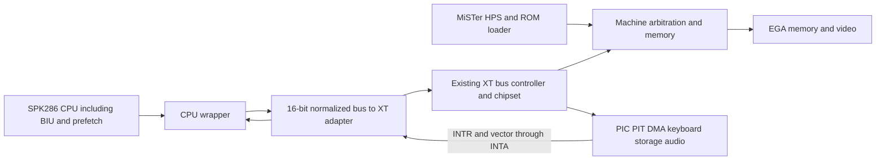

# PCAT-286_MiSTer — SPK286 integration specification

**Document version:** 1.1  
**Prepared:** 2026-09-09  
**Status:** Initial specification; no implementation, FPGA build or machine boot is claimed.  
**Working directory:** `D:/GitHub/PCAT-286_MiSTer`  
**Initial machine profile:** XT-compatible platform with the SPK286 CPU in Real Mode.  
**Long-term direction:** A separate, progressively developed 286/AT machine core for MiSTer.

## 1. Purpose and relationship to SPK286 Phase 8

Create a new MiSTer core by reusing the existing PCXT-EGA_MiSTer machine implementation and replacing its MCL86 CPU subsystem with SPK286. Preserve the existing chipset, memory infrastructure, video, storage, audio, keyboard and MiSTer integration wherever their contracts remain applicable.

The initial deliverable is a **286 CPU running in an XT-derived machine**. The project name describes its intended evolution; replacing the CPU alone does not implement an IBM PC/AT chipset, Protected Mode, extended-memory services or full AT compatibility.

**Explicit user priority: deliver the usable SPK286 machine core first, even if the existing PCXT BIOS fails. BIOS investigation/adaptation is a separate subsequent phase and task.** Core acceptance uses a project-owned diagnostic ROM and direct integration tests; successful execution of the production BIOS, POST or DOS is not a prerequisite. Do not bundle BIOS source changes into the core implementation task.

The current `SPK286/docs/PHASE8_PREPARATION.md` defines incremental Phase 8 as CPU-only whole-program interaction verification. It treats a BIOS boot and a MiSTer port as downstream machine work. This project is that downstream consumer. Use separate milestone identifiers `I0`–`I6` below to avoid silently redefining SPK286's phase numbering.

CPU-only interaction programs can support both efforts. Passing this project's adapter tests does not automatically complete SPK286 Phase 8, and an accepted SPK286 phase does not automatically validate the complete machine.

This document specifies the implementation to be requested in a subsequent session. Creating this document does not authorize the current documentation session to copy the core, modify the source repositories, build firmware or publish a new repository.

## 2. Workspace roles and source selection

The user will associate the actual directories with the implementation session. The supplied paths take precedence over preparation-time paths.

| Role | Preparation-time location | Use in the implementation session |
| --- | --- | --- |
| New machine workspace | `D:/GitHub/PCAT-286_MiSTer` | Destination for imported sources, adapter RTL, tests and documentation |
| CPU source | `D:/GitHub/SPK286` | Read the accepted CPU implementation, generated microcode, compiler, contracts and verification assets; import a pinned snapshot |
| Machine source/reference | `D:/GitHub/PCXT-EGA_MiSTer` | Copy the selected machine baseline and use it as the compatibility reference |

At preparation time:

- The destination contained an initialized Git repository, with no commits and no configured remote.
- The inspected local PCXT checkout was clean on `main-new`, at `4d04aa3314097ce4222e6c0ff7ab173d6bd0b15a`.
- SPK286 was on `codex/phase7-realmode-completion`, with HEAD `e2bc4a7839cd0aa594b543d8dcaaf253c310a63a` and substantial staged Phase 7 closure work. HEAD alone does **not** identify that staged implementation or prove final closure.
- Earlier research examined PCXT revision `7bbdbbbe5ba1c2737da88943bbc668f5520faa31`, whose CPU interface differs from the inspected local baseline. Do not combine interface assumptions from these revisions.

These are observations, not instructions to reset either source repository. At session start, inspect current branches, commits, dirty state and applicable `AGENTS.md` files. Select the exact attached PCXT revision deliberately. Do not silently substitute a newer remote branch or an older research clone.

Use an accepted Phase 7 CPU delivery, with review/validation records bound to its actual sources. The five approved evidence notes are not barriers to integration. If Phase 7 delivery is still being finalized, proceed with independent scaffolding, baseline inventory, adapter design and mock-bus tests; do not race an active CPU session by copying a moving staged tree and calling it released.

Record source URLs, commits, file hashes, source-selection decisions, dirty overlays if explicitly used, and imported file lists in a compact provenance manifest. Normal builds must not depend on absolute paths into the user's reference folders.

## 3. Initial scope

### Required

1. Import a reproducible PCXT machine baseline into the new repository while preserving its copyright notices, licenses, build assets and required submodules/IP sources.
2. Import the complete synthesizable SPK286 CPU and matching generated microcode, with enough authoritative source/tooling to reproduce those generated artifacts.
3. Implement a CPU wrapper and a machine-side bus adapter.
4. Preserve the XT memory/peripheral model initially, with explicit address adaptation and correct byte transactions.
5. Connect interrupts, interrupt acknowledgements and shared-bus ownership correctly.
6. Add deterministic whole-program simulations and integration tests before firmware boot experiments.
7. Produce a reproducible Quartus build for the selected MiSTer target, with fit/timing evidence.
8. Deliver the core with a project-owned diagnostic ROM and reproducible loading/testing instructions; report simulation, FPGA build and physical-board results separately. Record any observed production-BIOS failure for the later BIOS task without making that boot a core acceptance requirement.

### Deferred beyond the initial integration

- AT-specific dual PIC/DMA organization, 8042, AT RTC/CMOS semantics, AT BIOS behavior and 16-bit ISA expansion.
- Protected Mode, descriptor/task machinery, LOADALL and operating systems requiring unimplemented CPU features.
- Extended RAM/HMA support and an AT A20-control mechanism.
- Historical cycle-exact 80286 timing or advertised MHz equivalence.
- New video/audio/storage implementations or a wholesale rewrite of the PCXT chipset.
- A complete 80287 implementation.
- Production BIOS adaptation, CPU/FPU detector changes, option-ROM compatibility fixes and a successful POST/DOS boot; these belong to the separate BIOS phase defined in section 11.

The existing XT implementation may already contain peripheral extensions. Retain and document them as baseline features; their presence is not evidence that the machine is an AT.

## 4. Reuse and repository layout

Reuse machine code by importing a selected source snapshot. Do not copy the source repository's `.git` directory over the destination repository, copy ignored build trees indiscriminately, or overwrite this specification during import. Preserve source hierarchy initially to limit unrelated changes.

Suggested additions to the imported tree:

```text
PCAT_286_MISTER_SPEC.md
README.md
vendor/spk286/
  rtl/
  microcode/source/
  microcode/generated/
  tools/                       # matching generation/verification dependencies
  docs/                        # relevant CPU contracts and evidence policy
rtl/spk286_integration/
  spk286_machine_cpu.sv
  spk286_xt_bridge.sv
  spk286_xt_address_map.sv
  spk286_integration.qip
sim/spk286_integration/
tests/firmware/
scripts/
docs/SOURCE_PROVENANCE.md
docs/CPU_INTEGRATION.md
docs/INTEGRATION_VERIFICATION.md
docs/KNOWN_LIMITATIONS.md
docs/INTEGRATION_HANDOFF.md
```

Names are proposed interfaces/layout, not existing files. Adapt them coherently to the selected baseline. Keep the MiSTer framework's expected `sys_top`/`emu` structure and HPS protocol. Rename project/build/user-visible identifiers deliberately so the new `.rbf`, configuration and game/ROM paths do not overwrite the original PCXT installation.

Keep the MCL86 implementation available through the imported baseline or an optional build-time baseline configuration for comparisons. Only one CPU may own the machine in any build; the default integration target must instantiate SPK286. A runtime CPU selector is not required.

### CPU and microcode import rules

SPK286 is not a replacement image for MCL86's `rtl/8088/microcode.mem`. Replace the MCL86 EU/BIU/prefetch subsystem with the complete SPK286 subsystem and adapt its external contract.

The inspected SPK286 source list is generated package first, generated ROM second, then CPU RTL, as defined in `scripts/rtl_sources.sh`. Its inspected ROM is generated SystemVerilog, with a combinational case implementation; it does not currently require an interchangeable MCL86-style `.mem` image. Recheck the accepted revision rather than inventing a required `.mem`, `.mif` or ROM loader.

Preserve authoritative `.mc` sources, matching compiler/version, generated package/ROM and consistency checks. Import all transitive synthesizable CPU dependencies. Do not manually edit generated microcode, reuse MCL86's microcode format or replace SPK286's BIU with MCL86's `biu_max`.

Record the third-party notices already present in the machine tree, including its root `LICENSE` and component-specific notices. Preserve upstream attribution during copying; do not invent a new license for imported SPK286 sources if none is supplied.

## 5. Architecture and ownership



SPK286 owns instruction execution, architectural state, FLAGS, exceptions, prefetch, logical operand sequencing and its normalized physical bus transfers. The adapter owns translation of those transfers into the selected machine's transactions. The chipset/device owns the actual side effect. Define the acceptance boundary between all three explicitly.

The adapter must not become a second x86 decoder or CPU emulator. It must not inspect opcodes, expected test signatures or register values to repair machine behavior.

## 6. CPU wrapper contract

Use the actual accepted `rtl/spk286.sv` interface. Preparation-time machine-facing signals are:

| Signal group | Meaning and integration requirement |
| --- | --- |
| `clk`, `reset` | Core clock and active-high synchronous CPU reset |
| `execute_enable` | Enable architectural execution; this is not a general clock-enable pin |
| `ready`, `data_in[15:0]` | Complete the outstanding normalized transfer and return correctly positioned read data |
| `address[23:0]`, `data_out[15:0]` | Physical address and lane-positioned write data |
| `bus_valid`, `bus_write`, `data_oe`, `bus_bhe_n` | Request, direction and active byte lanes |
| `bus_status[3:0]` | Encoded normalized cycle class, translated explicitly below |
| `bus_lock`, `hold_request`, `hlda` | Atomic ownership and CPU bus grant |
| `intr`, `nmi` | Synchronous CPU event inputs after machine synchronization |
| `halted`, `shutdown`, error/debug outputs | Diagnostics and machine lifecycle observations |

Tie setup/debug **inputs** to explicit safe values in the production wrapper: disable GPR/IP/FLAGS/segment writes, external redirect and manual fetch requests; fix unused indexes/data deterministically. Allow automatic fetch/execution using the documented core path. Debug **outputs** may feed nonintrusive trace/status logic or remain unconnected as allowed by lint.

Start from the native reset state, not a testbench state injection. The first CPU physical fetch must be `0xFFFFF0`, with visible CS=`F000`, hidden CS base=`FF0000`, and IP=`FFF0`. A subsequent far transfer must update CS:IP and prefetch through ordinary CPU execution.

Do not hide `unsupported_opcode`, `microcode_fault`, `control_error` or `shutdown`. Capture enough context to diagnose failures. HLT is an expected architectural state that can resume on an eligible event; it is not automatically a successful test or a machine failure. Shutdown must be observable and must not silently synthesize an interrupt return or unsupported AT reset sequence.

## 7. Normalized bus to XT conversion

The inspected local `i8088` interface is a multiplexed 20-bit address/8-bit data boundary with maximum-mode status and two clock inputs. SPK286 exposes a retained 24-bit/16-bit request interface. Directly connecting their pins is invalid. See the pinned [local-baseline CPU interface](https://github.com/spark2k06/PCXT-EGA_MiSTer/blob/4d04aa3314097ce4222e6c0ff7ab173d6bd0b15a/rtl/8088/i8088.v).

### 7.1 Retention and completion

- Snapshot a new SPK286 request exactly once. Hold its address, status, direction, lane mask and write payload through downstream waits.
- Assert CPU `ready` only for that outstanding request after every required downstream beat has completed. Return assembled read data on that completion edge.
- A high downstream idle READY is not a completed transaction. Establish the actual bus-cycle phase and ownership before accepting it.
- Consecutive requests may keep `bus_valid` high and may have identical addresses/data. Do not require a falling edge of `bus_valid`, or deduplicate by payload, to recognize the next request.
- Consume each read side effect and perform each write exactly once. READY stalls, refresh, pause, repeated valid cycles and CDC latency must not duplicate effects.
- For queued memory writes, distinguish bridge acceptance from physical SDRAM commit. A queue must retain accepted writes with a documented ordering/reset policy; otherwise acknowledge only actual completion.
- Reset may discard unaccepted work. Already accepted side effects must remain represented and may not be replayed after reset. A CPU redirect drains the original accepted transaction; it does not undo a device action.

### 7.2 Byte lanes and serialization

Start with an 8-bit downstream path for all CPU transfers. Prefer a simple fully tested serializer before any wider-memory optimization.

| SPK286 transfer | Selected data | Required XT byte beats |
| --- | --- | --- |
| Even byte: A0=0, BHE_n=1 | D7:0 | One at A |
| Odd byte: A0=1, BHE_n=0 | D15:8 | One at A |
| Aligned word: A0=0, BHE_n=0 | Low D7:0, high D15:8 | One at A, then one at A+1 |
| A0=1, BHE_n=1 on an ordinary memory/port request | No lane selected | Protocol error; no fabricated access |

INTA is a separate cycle class and must not be treated as an ordinary lane-based memory operation.

SPK286 already splits an odd logical word into two CPU physical transfers. Its first transfer selects the high lane at the odd address; its second selects the low lane at the next address. Serialize only the lanes in each received physical transfer. Do not split those single-lane transfers again or alter the CPU's assembly order.

Map addresses independently for each downstream byte, including boundary crossings and device selects. Keep EGA and I/O side effects byte-accurate. For a later baseline with a private 16-bit SDRAM path, record its actual handshake and limit any optimization to eligible aligned memory; do not assume the private path applies to EGA, I/O or the inspected 8-bit baseline.

### 7.3 Cycle-class conversion and the 8288 path

The preferred initial approach is to generate the expected XT bus phases/status around the existing KF8288/chipset interface, preserving device implementations. Inspect its ALE, status latch, command strobes, READY and turnaround behavior. A combinational status conversion alone is not a complete bus adapter.

The inspected status mappings are:

| SPK286 normalized status | Meaning | KF8288 `processor_status` |
| --- | --- | --- |
| `0x0` | Interrupt acknowledge | `000` |
| `0x9` | I/O read | `001` |
| `0xA` | I/O write | `010` |
| `0xD` | Code fetch | `100` |
| `0x5` | Memory read | `101` |
| `0x6` | Memory write | `110` |
| `0xF` / no request | Passive | `111` |

**Do not truncate `bus_status` to three bits:** CODE `0xD` would incorrectly become memory-read `101`. Translate direction, polarity and cycle phase explicitly. Handle any required HALT indication separately from ordinary request status.

Replacing the copied chipset's 8288-facing frontend with an explicit transaction frontend is an acceptable alternative only if it reduces complexity demonstrably and preserves arbitration/peripheral regressions. Choose one approach and document its contract; do not maintain two concurrent bus owners.

## 8. Initial machine address profile

Define an explicit `XT_COMPAT` mapping in the machine adapter. The initial memory profile projects the CPU physical address to the existing 20-bit XT address space, independently for each byte. Thus CPU `0xFFFFF0` reaches XT `0xFFFF0`, where the selected BIOS reset entry resides.

This projection is a machine compatibility policy, not an internal CPU change and not a model of a complete AT A20 gate. Keep the full 24-bit address in CPU traces. Do not change the CPU reset vector, CS cache or address calculation to make the XT ROM visible. Extended memory is not exposed by this initial profile.

Preserve the selected baseline's actual memory map, including conventional RAM, EGA apertures, option ROMs, UMB/EMS configuration and main BIOS. Build a checked table from its decode logic; do not copy typographical address errors from prose documentation. EMS is a chipset facility, not proof of linear 286 extended memory.

I/O cycles must use the I/O address/decode path, never the RAM mapping path. Preserve the full observed CPU address in traces, including the existing CPU boundary behavior for a word starting at port `FFFF`. Specify the downstream port-width/alias policy and test it; do not normalize addresses silently in the CPU.

Unmapped reads, ignored writes, ROM protection, load-time writes and enabled device aliases must have deterministic documented behavior consistent with the chosen machine profile. Test word transfers that cross mapping boundaries.

Keep future profiles separate: an AT memory map with reset ROM aliases, A20 control and extended RAM will need its own specification and validation.

## 9. Interrupts, DMA and shared ownership

### PIC and INTA

Connect the existing PIC's interrupt output to synchronized SPK286 `intr`. Each CPU INTA transfer must generate one properly phased chipset acknowledgement; SPK286 produces two acknowledgements for an external interrupt and samples the vector from the second transfer's D7:0.

Do not merge the two acknowledgements, acknowledge the PIC merely on seeing INTR, or supply a hard-coded vector. Verify the PIC's mode and vector timing, spurious/deasserted requests, READY waits and handler/IRET return.

Preserve the selected CPU's LOCK interval, including its recorded INTA chain through the first complete frame push. Translate active-high `bus_lock` to the machine's active-low lock signal. Bus ownership may not be stolen between serialized beats or during a CPU atomic interval.

### NMI

The inspected PCXT top ties CPU NMI low. Preserve that initial machine configuration unless the selected baseline supplies a real source. Test NMI through a controlled verification input; do not invent parity/channel-check hardware or present a tied-low input as a physically verified NMI path. Retain the CPU's recorded NMI policy.

### DMA, refresh and HPS access

Audit all bus owners: CPU, DMA, refresh, BIOS/ROM loader and other external access. In the inspected baseline, the arbiter derives a hold acknowledgement internally from CPU status; it does not directly handshake with a CPU HLDA pin. This cannot be assumed correct for SPK286.

Expose and connect a real hold/grant path in the copied machine wrapper/arbiter, or prove an equivalent serialized ownership mechanism. Prefer using SPK286 `hold_request`/`hlda` explicitly. Grant DMA/external access only when the CPU has granted ownership and all relevant adapter beats have drained. Do not grant between the halves of retained odd words or while LOCK is active.

Separate the reset-held ROM-loading owner from runtime arbitration: during startup, the CPU can remain in reset while HPS fills memory. During runtime, loader/debug access must obtain ownership normally. Do not wait for HLDA from a reset-held CPU to perform the initial ROM load.

Retain and rerun existing refresh/write-retention tests. A disappearing DMA request, long READY stall, reset during a transfer or simultaneous refresh/CPU write must not corrupt data or deadlock the new bridge.

## 10. Clock, reset, pause and performance policy

Choose an explicit clocking design after inspecting the selected machine's PLLs and CPU/chipset enables:

- Prefer a common CPU/adapter/chipset clock where the CPU meets the measured timing requirement, with clock enables controlling the legacy bus phases.
- If different CPU/chipset clocks are necessary, use a bundled request/response handshake or a properly designed asynchronous FIFO with retained payloads. Synchronizing each address/data bit independently is invalid.

SPK286's `execute_enable` is not a global clock enable. Do not pulse it as an instruction-speed divider or assume READY stalls freeze all CPU state. Prefetched instructions and internal state may still progress. Do not use arbitrary combinational clock gating.

Synchronize external event inputs appropriately; preserve NMI events across the chosen crossing. Assert/release each domain's reset using its actual contract. Keep the CPU held until clocks, memory initialization and selected ROM loading are ready. Resetting the CPU must also clear incompatible bridge/CDC state without replaying stale responses.

Audit the existing OSD pause and speed controls. Legacy MCL86 cycle counters, `biu_done`, `cycle_accrate` and `shift_read_timing` do not automatically map to SPK286. Implement a validated equivalent or make the unsupported control unavailable in the initial profile, documenting the reason. A bus stall is not a full-system pause guarantee.

Start at one conservative measured operating point. Keep real waits, peripheral cadence and ownership correct. Do not accelerate PIT/video/storage merely because the CPU runs faster. Do not label the CPU frequency or throughput as historical 286 MHz without appropriate measurement and evidence.

Functional semantics, machine bus scheduling and future Accurate/Fast/Max timing policy must remain separate. Do not insert meaningless CPU micro-operations to reproduce XT bus delays.

## 11. Separate BIOS phase — after core delivery

### Core task: diagnostic ROM only

Execute a small project-owned Real Mode diagnostic ROM through the real SPK286 and the new bridge. It must start from the native reset vector, perform a far jump, initialize segments/stack, exercise memory and ports, and report an exact signature through ordinary architectural writes. No setup/debug register injection or expected-result-driven devices are permitted in the pass path. This is a core verification asset, not an adaptation or replacement implementation of the production BIOS.

Deliver the core and its usable diagnostic configuration before beginning production BIOS work. The core must preserve a normal ROM-loading path so the subsequent BIOS task can use it without changing the integration architecture.

An optional observation of the existing, unchanged BIOS may be recorded if convenient. It must not become an open-ended investigation, mandatory boot gate or reason to postpone core delivery. Record the image hash, last observed POST/CS:IP, opcode or bus activity, and known limitations where available. A BIOS timeout is not proof of a CPU bug or proof that the CPU is correct.

Known unsupported firmware assumptions and unknown BIOS compatibility issues remain in the BIOS backlog. If existing core tests or a reduced reproducer demonstrate a violation of the specified CPU/adapter contract, correct that core defect; do not relabel it as a BIOS adaptation issue. Successful POST/DOS execution remains outside core acceptance even after such a correction.

### Subsequent task: production BIOS compatibility

Create this as a separate task only when the user requests its execution. The following is its planned scope, not work authorized as part of core implementation:

1. Inventory the selected production BIOS and option ROMs, recording image hashes, build/configuration, reset entry, required instructions and device assumptions.
2. Reproduce and classify boot failures against the already delivered core.
3. Make explicit firmware configuration/source changes needed for the 286-in-XT profile.
4. Test POST, option ROMs, storage boot and software execution, with their own review and delivery.

Prefer reproducible source-built firmware or user-supplied images with clear provenance; do not include unrelated disk contents or credentials in the repository.

The inspected Micro8088 `SW/8088_bios/src/cpu.inc` explicitly targets 8088/80C88/V20 identification. It uses TF/segment probes and invokes FNINIT/FNSTCW in the FPU detector. Those ESC/NPX operations are outside the recorded Phase 7 CPU scope. The existing BIOS cannot be assumed runnable unchanged.

In that separate BIOS task, an explicit downstream firmware build/configuration that reports no FPU and avoids unsupported probing may be appropriate. Preserve the truth of the CPU/machine model, record the source change, and test it. Do not disguise an unsupported CPU instruction as a NOP, forge a CPU capability or patch ROM bytes without provenance. Do not implement this firmware change during the core task.

If BIOS work later requires an actual CPU feature, record a narrowly scoped CPU dependency with independent semantics and verification. Develop it as a separately scoped upstream CPU change or a clearly identified reviewed vendor patch; do not quietly mutate the reference SPK286 checkout. Missing ESC/NPX features outside the accepted CPU baseline do not block the initial core delivery.

The later BIOS task should observe POST progression, vector setup, PIT/PIC operation, keyboard, EGA ROM initialization, XTIDE/floppy access and eventual DOS/FreeDOS command execution. A visible splash or POST byte alone is not an operating-system boot. A DOS prompt does not establish Protected Mode or full AT compatibility.

## 12. Verification requirements

Use the smallest meaningful tests first, then the broader required regression. Tests must inspect accepted effects and independent expected state, not merely compare a trace against itself.

| Layer | Required observations |
| --- | --- |
| Imported baseline | Reproducible source inventory and available existing machine checks; identify inherited failures before blaming SPK286 |
| CPU import | Generated microcode consistency, unchanged source hashes, relevant inherited CPU checks and phase acceptance records |
| Adapter simulation | Lane steering, explicit status conversion, retained requests, identical back-to-back requests, byte-beat counts and read assembly |
| Lifecycle | Idle/stale READY, extended waits, reset/redirect, pause behavior, LOCK, HOLD/HLDA, DMA/refresh and loader contention |
| Event path | Real PIC programming, two INTA cycles, vector sampling, handler stack/frame/IRET and HLT wakeup |
| Whole CPU programs | Reset-to-signature, string transform, REP/event resume, input/output stream, stack/far-call interactions and fault recovery |
| Machine memory/devices | EGA latch/byte behavior, ROM protection, address aliases, memory-map boundaries and port side effects |
| FPGA build | Synthesis/elaboration, fit, resource use, constrained clocks, timing results and reproducible `.rbf` |
| Hardware | Actual board/configuration/diagnostic-ROM hashes, loading steps, diagnostic signatures and remaining limitations; production BIOS boot is tracked separately |

Run the new portable adapter/CPU integration benches in Icarus and Verilator where supported. Vendor PLL/HPS/SDRAM primitives may require documented simulation models or a vendor flow; report the modeled boundary and do not claim whole-machine simulation when only a subsystem ran.

Add targeted failure-detection checks for critical integration mistakes: wrong CODE status, swapped high-byte lane, early acknowledgement of a word, duplicated port write, stale INS data, one instead of two INTA cycles, and premature DMA grant. Each must fail a relevant check with a passing pristine control. Do not require a huge unrelated mutation campaign simply to copy an unchanged peripheral.

Programs need a bounded deadline **and** independent signatures/state/transaction checks. Timeout, HLT or disappearance of bus traffic is not a PASS. Include guard regions and changing device input data to detect duplicates, omissions and stale responses.

Keep evidence categories separate: CPU hardware-derived SingleStep replays, synthetic adapter tests, emulator comparisons, whole-program simulation, Quartus results and physical-board boot. Do not add machine tests to the physical CPU case count or treat 86Box agreement as a new physical 286 capture.

## 13. CPU evidence policy carried into this consumer

Respect SPK286 D-026/D-037 functional acceptance. The following known questions remain explicit, nonblocking evidence notes:

- `failed-iret-nmi`.
- `sti-old-if`.
- `fault-tf`.
- `rep-zero-count-event-order` under the recorded zero-element/next-IP completion policy.
- `e7-incomplete-physical-capture` for the exact allowlisted record only.

Import or reference the accepted machine-readable policy/register. The incomplete E7 physical record remains NOT EVALUABLE, not a physical PASS; all evaluable cases remain required by the CPU's own gate. Historical 80286 timing remains uncertified.

These notes do not block adapter work, functional CPU consumption, FPGA compilation or a boot experiment. Do not reopen them as prerequisites or change CPU policies to mimic MCL86/8088 quirks. A new demonstrated executable defect or integration race is actionable and must be fixed.

Publication of the E7 issue remains pending by user request. No external messages or issue publication are part of this specification.

## 14. Quartus and MiSTer build requirements

The inspected PCXT baseline targets Cyclone V `5CSEBA6U23I7`, uses `sys_top`, and records Quartus 17.0.2 Lite in its project. Confirm the selected baseline, installed toolchain and board rather than assuming a newer tool is interchangeable.

Create a project-specific QIP/source manifest with correct package order and unique module definitions. Do not compile MCL86 and SPK286 as simultaneous CPU owners. Preserve the required `sys` framework and vendor IP dependencies. Record the exact build command and project/revision name.

The inspected SPK286 generated ROM may map differently in Quartus than in Yosys. Check actual resource/ROM inference; do not equate generic Yosys cells with Cyclone V ALMs or promise FPGA fit in advance. If inference/timing requires a CPU implementation change, keep source generation authoritative and revalidate its semantics.

Update SDC constraints for the real CPU/bridge clocks and their crossings. Old constraints naming MCL86 hierarchy or blanket false paths are not proof of timing closure. Investigate newly unconstrained paths and critical warnings; do not suppress them solely to obtain a green build.

Report ALMs/registers/RAM resources, achieved constraints, setup/hold results, tool/version, source manifest and output hash. Distinguish successful synthesis from successful fit/timing, and an `.rbf` file from an `.rbf` tested on hardware.

Do not flash or reconfigure a board, overwrite installed MiSTer files, or write to user disk images during the specification task. A subsequent execution prompt must define the available hardware/test destination and authorize those actions if required.

## 15. Incremental delivery milestones

| Milestone | Deliverable | Acceptance boundary |
| --- | --- | --- |
| **I0 — Baseline and provenance** | Imported selected PCXT sources, preserved notices, source manifest, reproducible baseline build instructions | Existing repository preserved; imports identified; baseline failures disclosed |
| **I1 — CPU packaging and wrapper** | Accepted SPK286 snapshot, deterministic generated artifacts, integration QIP and safe wrapper wiring | CPU elaborates; import checks pass; MCL86 is absent from the SPK286 CPU hierarchy |
| **I2 — XT bus adapter** | Retained request bridge, lane/status/address translation, explicit arbitration/clock contracts | Dual-simulator focused tests pass, including failure-detection controls |
| **I3 — Reset-to-program execution** | Project-owned diagnostic ROM executing on SPK286 through the machine adapter | Native FFFFF0 trace, correct far jump, complete signatures and exact transaction counts |
| **I4 — Machine events and ROM loading** | PIC/INTA, DMA/refresh/loader behavior and a usable diagnostic-ROM configuration | Required interaction tests pass; ROM loading works; production BIOS compatibility is not a gate |
| **I5 — MiSTer FPGA candidate** | Reproducible complete-machine Quartus output and timing/resource report | Build/fit/constraints pass; remaining hardware checks clearly pending |
| **I6 — Board diagnostic validation** | Actual board diagnostic results, repeatable loading procedure and core handoff | Diagnostic exercises the real core; BIOS/POST/DOS success is not required; no unsupported AT/timing claim |

Each milestone is independently deliverable. An unavailable board must not erase successful simulation/FPGA build work or trigger repeated full regressions; mark I6 pending and deliver the verified I5 artifact. Missing physical confirmation of the five CPU notes does not prevent I0–I6 acceptance under the declared functional profile.

**Core delivery boundary:** deliver the verified core, build artifacts and diagnostic configuration once the applicable core milestones pass, even when the unchanged production BIOS is known to fail. A build-only I5 result must still disclose that physical-board I6 validation is pending; a BIOS failure must not downgrade a passing core diagnostic into a failed core milestone.

The independent later phase uses different identifiers: **B0** BIOS inventory/reproduction, **B1** explicit firmware adaptations, **B2** POST/option-ROM/software validation. B0–B2 are not prerequisites of I0–I6 and are not included in the first core implementation task.

The first implementation session should progress through I0–I3 as a concrete vertical slice, preparing I4 dependencies alongside it. Continue toward a usable I5/I6 core delivery when the requested session scope and available tools permit. Do not start B0–B2 to resolve a BIOS failure before delivering the core. Do not turn the entire long-term AT roadmap into a prerequisite for the first SPK286 diagnostic program.

## 16. Source safety, development workflow and handoff

Treat attached SPK286 and PCXT directories as read-only references unless the user explicitly includes source-repository fixes in the subsequent task. All new machine glue and chipset adaptations belong in this destination. Isolate any necessary CPU patch, state its provenance and upstreaming plan, and run affected CPU checks before relying on it.

Preserve the destination's Git metadata and existing files. Use a working branch for implementation, inspect diffs, stage relevant sources explicitly, and commit verified increments. Do not force-push, rewrite existing history or import build/corpus/private disk contents wholesale. The preparation-time destination has no remote; do not invent a GitHub publication destination or borrow the PCXT remote for pushes.

Communicate with the user in Spanish. Keep repository documentation, source comments, identifiers and commit messages in English. In the implementation session, proceed autonomously on reversible, authorized work and explain concrete unresolved dependencies without repeatedly asking for decisions already fixed by this specification.

The implementation handoff must include:

1. Actual source paths/revisions/manifests and any vendor patches.
2. Diagram and exact CPU/bridge/chipset ownership, lane, reset and clock contracts.
3. Imported versus changed files and reasons for chipset changes.
4. Reproducible commands, actual test totals, expected signatures and diagnostic artifacts.
5. Diagnostic ROM/image hashes, selected loading configuration and a separate backlog for the later production BIOS task.
6. FPGA tool/version, fit/timing/resource results and `.rbf` hash when built.
7. Hardware results actually observed, remaining milestones and known evidence notes.
8. Git state and a clean recovery/build procedure independent of the original absolute source paths.

Report milestone progress precisely. For example, “SPK286 reset-to-program integration validated; FPGA/board validation pending” is a valid intermediate delivery. After the applicable core checks pass, “Core delivered and usable with the diagnostic ROM; production BIOS fails and its adaptation is a separate pending task” is an acceptable final core outcome. “PC/AT-compatible 286 core complete” is not justified by the initial XT-derived profile.

## 17. Preparation sources

The design requirements above are grounded in the local sources inspected on 2026-09-09. They must be rechecked against the actual associated directories when implementation begins.

- [SPK286 CPU top](D:/GitHub/SPK286/rtl/spk286.sv), [BIU](D:/GitHub/SPK286/rtl/spk286_biu.sv), [source ordering](D:/GitHub/SPK286/scripts/rtl_sources.sh), [generated ROM](D:/GitHub/SPK286/microcode/generated/spk286_microcode_rom.sv).
- [SPK286 Phase 8 preparation](D:/GitHub/SPK286/docs/PHASE8_PREPARATION.md), [bus contract](D:/GitHub/SPK286/docs/BUS_INTERFACE.md), [functional policy](D:/GitHub/SPK286/docs/PHASE7_FUNCTIONAL_POLICY.md), [project rules](D:/GitHub/SPK286/AGENTS.md).
- [Inspected PCXT top at the local revision](https://github.com/spark2k06/PCXT-EGA_MiSTer/blob/4d04aa3314097ce4222e6c0ff7ab173d6bd0b15a/PCXT-EGA.sv), including the MCL86 CPU instance and chipset connection.
- [Local chipset](D:/GitHub/PCXT-EGA_MiSTer/rtl/KFPC-XT/HDL/Chipset.sv), [bus arbiter](D:/GitHub/PCXT-EGA_MiSTer/rtl/KFPC-XT/HDL/Bus_Arbiter.sv), [READY logic](D:/GitHub/PCXT-EGA_MiSTer/rtl/KFPC-XT/HDL/Ready.sv), [KF8288](D:/GitHub/PCXT-EGA_MiSTer/rtl/KFPC-XT/HDL/KF8288/HDL/KF8288.sv).
- [Micro8088 CPU/FPU probes](D:/GitHub/PCXT-EGA_MiSTer/SW/8088_bios/src/cpu.inc), [source manifest](D:/GitHub/PCXT-EGA_MiSTer/files.qip), [Quartus project](D:/GitHub/PCXT-EGA_MiSTer/PCXT-EGA.qsf), [timing constraints](D:/GitHub/PCXT-EGA_MiSTer/SYSTEM.sdc).

These links document preparation provenance; they are not runtime build dependencies.
