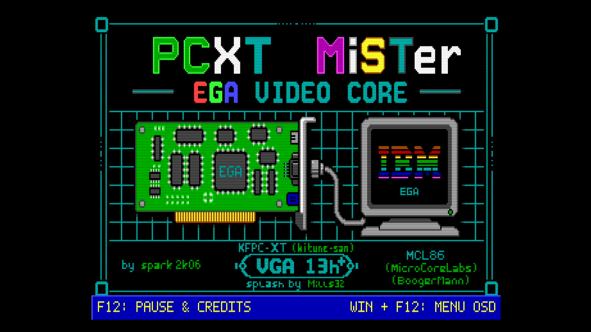

# PCAT-286 for [MiSTer FPGA](https://mister-devel.github.io/MkDocs_MiSTer/)

An SPK286 CPU integrated with a normalized IBM PC/AT MiSTer machine by
[@spark2k06](https://github.com/spark2k06/).

Discussion and development of the core take place in the
[MiSTerFPGA PCXT forum section](https://misterfpga.org/viewforum.php?f=40).



## Description

The repository contains one Quartus profile: `PCAT-286`. It builds the current
AT implementation with the complete [SPK286](vendor/spk286/README.md) CPU, BIU
and generated microcode, an AT bus, cascaded PIC, DMA/refresh, PIT, 8042,
RTC/CMOS, floppy/IDE storage and EGA video. See [known limitations](docs/KNOWN_LIMITATIONS.md)
and the [source provenance](docs/SOURCE_PROVENANCE.md).

The video path is a full EGA implementation. Earlier releases used the
[Graphics Gremlin](https://github.com/schlae/graphics-gremlin) CGA and Hercules
adapters from TubeTimeUS ([@schlae](https://github.com/schlae)); those have been
replaced, and CGA-compatible software now runs through the EGA path the way it
does on real EGA hardware. The EGA and VGA 13h+ behaviour is modelled on the
video emulation in [86Box](https://github.com/86box/86box).

Splash artwork by [@mills32](https://github.com/mills32).

For an architectural overview and possible future improvements, see the
[PCXT technical report](https://aitorgomez.net/pcxt-ega/core-report)
(source in [docs/report/](docs/report/CORE_REPORT.html)).

## Key features

* Complete pinned SPK286 CPU, BIU and generated microcode
* Six-byte prefetch queue and native 24-bit CPU address generation
* Native AT bus bridge with READY, LOCK, HOLD/HLDA and dual-byte handling
* Cascaded PIC, DMA/refresh arbitration, PIT, 8042 keyboard and RTC/CMOS
* Passive four-page SPK286 debug overlay for CPU state, architectural
  registers, live bus signals and accepted AT transactions;
  it includes a live snapshot counter and a splash-off blank-raster fallback
* **EGA video**: sequencer, graphics controller, attribute controller and a four-plane VRAM, around the UM6845R CRTC
* Dual EGA dot clock, 14.318181 MHz and 16.257 MHz, selected per mode as on real hardware
* CGA-compatible text and graphics behaviour, provided by the EGA rather than a separate adapter
* **Direct 15 kHz CRT output**, with the 350-line modes convertible to 480i or 240p from the OSD
* EGA-compatible text and graphics output; the legacy VGA/TSR path is not part
  of the single AT profile
* 640 KiB conventional memory plus the normalized AT extended-memory window
* EGA BIOS option ROM support (required — the card is initialised by its own ROM, as on real hardware)
* XTIDE support
* PC speaker audio from PIT channel 2
* EGA graphical boot splash

## Memory map

SPK286 generates a 24-bit physical address. The AT decoder retains the
normalized PC/AT map shown below; the ROM rows describe the normal
configuration after their images have loaded.

| Address range | Size | Core assignment | DOS availability |
| --- | ---: | --- | --- |
| `00000h–9FFFFh` | 640 KiB | Conventional SDRAM | Conventional memory |
| `A0000h–AFFFFh` | 64 KiB | EGA aperture | Reserved for video |
| `B0000h–B7FFFh` | 32 KiB | Selectable EGA monochrome aperture | Reserved for video |
| `B8000h–BFFFFh` | 32 KiB | Selectable EGA colour/text aperture | Reserved for video |
| `C0000h–C3FFFh` | 16 KiB | EGA option ROM | Reserved for EGA BIOS |
| `C4000h–EBFFFh` | 160 KiB | AT option/expansion region | Device- or ROM-dependent |
| `EC000h–EFFFFh` | 16 KiB | XTIDE option ROM | Reserved when an XTIDE ROM is loaded |
| `F0000h–FFFFFh` | 64 KiB | Main system BIOS | Reserved for system BIOS |
| `100000h–15FFFFh` | 384 KiB | Extended SDRAM | Extended memory |

EGA's graphics-controller map can select `A0000h–BFFFFh`, `A0000h–AFFFFh`,
`B0000h–B7FFFh` or `B8000h–BFFFFh`; the entire A/B area is therefore reserved
for video regardless of the active EGA map. VGA 13h+ owns `A0000h–AFFFFh`
while active: packed mode 13h uses its private packed framebuffer, while its
supported unchained profiles use the existing four EGA planes.

The expansion area is deliberately decoded by the AT device router and ROM
loader; there are no legacy UMB/EMS switches in the single project profile.

## DOS environment (CONFIG.SYS / AUTOEXEC.BAT)

`hdd/` ships a minimal reference setup for the AT profile. The active project
does not include the legacy sound, serial-mouse, UMB or EMS modules, so the
configuration intentionally contains only ordinary DOS settings:

```
FILES=40
BUFFERS=30
SHELL=C:\COMMAND.COM C:\ /E:256 /P
```

`hdd/AUTOEXEC.BAT` provides the matching boot environment and starts no
legacy device driver:

```
@ECHO OFF
SET PATH=C:\UTIL;%PATH%
REM PCAT-286 AT profile: PC speaker audio is generated by PIT channel 2.
```

The repository keeps both examples as [`hdd/CONFIG.SYS`](hdd/CONFIG.SYS) and
[`hdd/AUTOEXEC.BAT`](hdd/AUTOEXEC.BAT).

## Video

EGA is the active video hardware model, and it is what the machine reports to
software. Standalone CGA, Hercules and Tandy video are no longer selectable
paths: CGA-compatible programs work because the EGA implements the
CGA-compatible modes, which is how a real EGA card behaved.

The dot clock follows Miscellaneous Output bit 2, so 200-line CGA-compatible
modes run at 14.318181 MHz and the 350-line and MDA-compatible modes at
16.257 MHz, rather than one fixed rate for everything.

The *Hardware → Monitor* option models the four monitor switches on the IBM
EGA card. `IBM 5154/ECD` is the default full EGA configuration;
`IBM 5153/CGA` internally selects the card's 80-column CGA switch pattern and
makes the IBM EGA BIOS use its
200-line, 8×8 text tables; and `IBM 5151/MDA` selects the 720×350, 80×25
monochrome mode 7 configuration. The 5151 profile interprets the EGA connector's
Mono Video and Intensity pins as normal and bright white, so *Full Color* is
neutral and the separate *Display* option can tint it green, amber, or otherwise.
The same connector path supports EGA BIOS mode `0Fh`, 640×350 monochrome
graphics, in addition to mode 7 text.
Monitor changes remain pending until *Reset & apply settings*, as on the
physical card the switches were read during POST. The graphical boot splash
always uses the 5154/ECD colour profile; the selected monitor takes effect when
the BIOS starts after it.

### CRT output

The core drives a 15 kHz CRT directly, with no scaler in between. The 200-line
EGA and CGA-compatible modes reach the display at 15.7 kHz, the way the
original hardware drove one. VGA 13h+ with its `60Hz` setting is retimed onto
that same raster; its `Native` setting uses the standard 31.5 kHz / 70 Hz
VGA timing.

The `CRT 25%` and `CRT 50%` visual effects darken alternate scanlines. They
do not change the output timing or frequency. See [31 kHz monitors](#31-khz-monitors)
for output suitable for a 31 kHz display.

*Audio & Video → CRT H offset* and *CRT V offset* centre the picture. One pair
of values covers every mode that reaches a television. HDMI is unaffected by
any of this.

The 350-line EGA modes and MDA scan at about 21.8 and 18.4 kHz, which no 15 kHz
set will lock to. *Audio & Video → 350-line CRT* converts them:

* `Native` — the raster the card programs, unconverted. Default, and what an
  enhanced display, a 5151 or the scaler wants.
* `480i 15 kHz` — a standard interlaced television frame. All 350 lines are
  shown, half of them in each field.
* `240p 15 kHz` — a progressive 262-line frame. Steady, with no interlace
  flicker, but 350 lines are fitted into 224 and the rest are dropped.

The conversion captures a whole frame into the board's DDR3 and rebuilds the
raster from it, publishing only complete frames so a mode change landing
mid-picture cannot put half of one frame and half of another on screen. Nothing
is fed back to the emulated hardware: the CRTC, the display enable and the
retrace bits software polls behave identically whichever setting is chosen.

The CRT offsets deliberately do not move the `Native` 350-line picture. Those
modes do not go to a television, and they sit where the card's own registers
put them.

### 31 kHz monitors

There is no native 31 kHz output for EGA, CGA or MDA modes. Their 200-line
rasters are 15 kHz and the 350-line/MDA modes left on `Native` run at 18.4 to
21.8 kHz on the 16.257 MHz dot clock, below what a VGA monitor will accept.
The exception is VGA 13h+ in its `Native` profile, which uses a conventional
31.5 kHz / 70 Hz VGA raster. A multisync CRT or a flat panel on the analogue
port is otherwise served by the scaler. This core-specific section in
`MiSTer.ini` is a practical starting point:

```ini
[PCAT-286]
vga_scaler=1
video_mode=6
vsync_adjust=2
```

The section name is the core name embedded in the RBF, so these settings apply
only to PCAT-286 and do not change other cores. `vga_scaler=1` routes the
scaler to the analogue output, meaning the core's own 15 kHz rasters are not
used there. `video_mode=6` is MiSTer's built-in 640×480, 25.175 MHz preset
(31.47 kHz), so no modeline is required. `vsync_adjust=2` follows the core's
real 59.917 Hz instead of forcing 60 Hz, avoiding a repeated frame roughly
every twelve seconds and reducing scaler latency. That refresh is
non-standard: a CRT will normally accept it, but a flat panel may not, so use
`vsync_adjust=1` if the display rejects the signal.

Leave *350-line CRT* on `Native` here. The 480i and 240p conversions exist to
reach a television and have nothing to offer a monitor that can already show
350 lines progressively.

### VGA 13h+

The optional VGA 13h+ path is a deliberately bounded VGA extension. It adds a
256-entry DAC on ports `3C7h`–`3C9h`, the original packed
320×200×256 mode 13h at `A000h`, selected unchained four-plane profiles and a
fixed VGA planar 16-colour profile:

| Profile | Layout | Supported output sizes |
| --- | --- | --- |
| VGA mode 0Dh | Four one-bit colour planes | 320×200×16 |
| Mode 13h | Packed 320×200×256 | 320×200 |
| Unchained 320×200 | Four pixels per byte across four planes | 320×200 |
| Unchained 360×200 | Four pixels per byte across four planes | 360×200 |
| Unchained 320×240 | Four pixels per byte across four planes | 320×240 |

The extension starts disabled, exactly as on an IBM EGA, and `VGATSR.COM`
enables it through AT286CTL. `VGA 13h+ CRT` then selects its output raster:
`Native` uses the standard 800-clock, 31.5 kHz / 70 Hz VGA timing, while `60Hz`
keeps a 15.70 kHz / 59.9 Hz television-compatible raster. The 360×200 Native
profile retains a 912-clock line for its wider picture, and 320×240 borrows
vertical blanking.

An IBM-compatible warm boot clears the VGA 13h+ AT286CTL field when the BIOS
writes its standard `1234h` marker to `0040:0072`, so the private VGA raster
releases the connector and the original EGA text mode is visible again.
`VGATSR.COM` must be run again before another VGA session.

While the extension is active, the DAC feeds **every** video mode, not only VGA
13h+. This
matters for software that detects a VGA, switches to a 16-colour mode for
gameplay and then sets its colours through the DAC: Titus the Fox and
Prehistorik 2 both do this, and without it they render in the stock EGA palette.
Entries the program never wrote fall back to the EGA palette, so nothing changes
for software that does not touch the DAC.

`hdd/VGATSR.COM` is the packaged BIOS-side companion; its source is
`SW/vga/vgatsr.asm`. The EGA option ROM has no DAC
subfunctions — `INT 10h AH=10h` with `AL=10h/12h/15h/17h` are VGA additions and
an EGA BIOS drops them silently — so the TSR hooks `INT 10h` and serves them,
along with the queries a game uses to detect a VGA in the first place. It
refuses to install if the core does not expose the required AT286CTL interface,
so an older incompatible RBF is not falsely advertised as VGA-capable.

For VGA mode 0Dh, VGATSR first lets the existing EGA BIOS establish the normal
planar registers and BIOS state, then switches only the display fetch to the
fixed VGA raster. That renderer honours CRTC Start Address, Offset 20–23
(40–46 bytes per plane row) and horizontal pel panning, covering common
320×200 hardware scrolling without replacing the EGA implementation or adding
a programmable VGA CRTC. See
[the planar mode 0Dh scope](docs/vga-planar16-mode0d.md).

When it sets mode 13h, VGATSR also installs the IBM VGA CRTC baseline that
unchained software normally modifies. Within the profiles listed above, the
renderer honours CRTC Offset values 40–45 (80–90 bytes per plane row), CRTC
Start Address, Attribute Controller horizontal pel panning, one CRTC Line
Compare split with pel-panning suppression, and Maximum Scan Line values 0–7.
That covers hardware scrolling, page flipping, a virtual 336-pixel-wide map
and the simple status/window split used by software such as Cute Demo. CRTC
registers 00h–09h are readable as on VGA, so the read/modify/write updates of
R07 and R09 used by that software preserve the vertical timing and scanline
repeat bits. On exit, VGATSR restores the pre-VGA CRTC/attribute state before
chaining the requested EGA BIOS mode.

The core still recognises only the listed timing signatures after Chain-4 is
disabled; it is not a generic Mode X or full VGA CRTC implementation. Other
unchained resolutions, arbitrary timing generation, multiple splits, vertical
panning, VGA text/high-resolution modes and cycle-exact raster effects remain
outside this feature.

#### Should it stay off for EGA-only sessions?

For everyday use, loading the TSR doesn't break anything: the DAC only overrides
a palette entry that software has actually written, so an EGA game that never
touches `3C7h`–`3C9h` renders identically either way, and `VGATSR.COM` chains
every unrecognised `INT 10h` call straight through to the real BIOS.

But explicit activation exists for a reason, and not loading the TSR is the
right call when you want the machine to behave and be detected as a real EGA
with no VGA trace at all — this is why the ports are gated on the AT286CTL
state rather than left decoding permanently:

* **Port-level fingerprint.** With the extension active, ports `3C7h`–`3C9h` answer as
  a DAC even if no software ever calls the BIOS for one — a real IBM EGA
  doesn't decode those ports at all, its palette lives in the attribute
  controller. Software that fingerprints hardware by probing I/O ports
  directly, rather than going through `INT 10h`, can see that and conclude a
  VGA is present. Not loading the TSR leaves those ports closed so the card
  answers exactly as an EGA should, to a port probe as much as to a BIOS call.
* **BIOS-level fidelity.** With `VGATSR.COM` resident, `INT 10h AH=12h/BL=10h`
  ("Return EGA information") — a standard EGA call, not a VGA-only one — is
  answered by the TSR with a fixed value instead of being chained to your
  loaded EGA BIOS ROM. Not loading the TSR means every EGA BIOS call gets
  exactly what that ROM would answer, with nothing intercepted.

So: fine to load VGATSR for normal play, but omit it when you specifically want
authentic, untraceable EGA behaviour — testing against real hardware, for
example, or running EGA-only software with nothing else in the picture.

## Current configuration

* Single `PCAT-286` AT machine profile with SPK286
* EGA video active at boot
* CGA-compatible text and graphics behaviour through EGA
* Optional VGA 13h+ support through the EGA video path
* PC speaker audio driven by PIT channel 2

## Build

Compile the only Quartus project with:

```sh
quartus_sh --flow compile PCAT-286.qsf
```

The generated bitstreams are placed in `output_files/`, including
`output_files/PCAT-286.rbf`.

## Quick Start

* Build the EGA BIOS with `SW/ROMs/EGA/make_ega_bios_rom.py` and copy the
  resulting `ega_bios.rom` to the SD card. **The core cannot show a usable
  picture without it** — see [EGA BIOS — required](#ega-bios--required).
* Copy `releases/PCAT-286_20260910.rbf` to the MiSTer SD card and select the
  PCAT-286 core.
* Press Win + F12 on your keyboard.
  * Boot Splash Screen: select **No**, leave it persisted, and start the core
    directly in that state for reproducible SPK286 bring-up.
  * XT Bus Pace: select the retained bus pace.
  * FDD & HDD → HDD Image: FreeDOS_HD.img
  * System & BIOS → PCAT BIOS: select
    `tests/firmware/pcat286_event_diag.rom` for the verified diagnostic path.
  * System & BIOS → EGA BIOS: `ega_bios.rom`. **Required.**
* Choose Reset & apply settings.

The SPK286 side retains 16-bit requests and a six-byte prefetch queue. The AT
bridge handles aligned words and byte-lane transactions while the machine keeps
ownership of memory, I/O, interrupt and refresh arbitration.

### The F12 keys

* **Win + F12** opens the OSD. Once the OSD is open, F12 or Esc closes it.
* CPU pause is not exposed in this initial profile. SPK286 `execute_enable`
  remains asserted so an outstanding bus response cannot be lost.

## Known limitations

The exact functional, timing, BIOS and physical-validation boundaries are in
[`docs/KNOWN_LIMITATIONS.md`](docs/KNOWN_LIMITATIONS.md). In particular, there
is no historical 80286 MHz/cycle-accuracy claim, no production-BIOS result and
no physical-board result yet. The per-milestone outcome is recorded in
[`docs/MILESTONE_STATUS.md`](docs/MILESTONE_STATUS.md).

## Audio

The single AT profile exposes the PC speaker only. Its square-wave signal is
generated by PIT channel 2 and routed to both MiSTer audio channels.

## RTC/CMOS port

The previous CGA/Hercules-based core exposed its RTC/CMOS device at
`2C0h`-`2C1h`. The EGA core mirrors `3C0h`-`3CFh` at `2C0h`-`2CFh`, so an
index write there also lands on the attribute controller and blanks the
display until the next mode change. The RTC/CMOS is now decoded at
`340h`-`341h` instead. Tools that read it directly — `GET_RTC.EXE` and the
`x86_launcher` AppId handled by `LAUNCHER.EXE` — need to be pointed at the
new port.

## ROM Instructions

ROMs are loaded from the **System & BIOS** section of the OSD. It provides slots
for the PCAT main/diagnostic ROM, an optional XTIDE ROM at `EC00h`, and the EGA BIOS,
which is required — see [EGA BIOS — required](#ega-bios--required) below.
Once loaded, a ROM remains available on subsequent boots until it is replaced.
Original and copyrighted system ROMs can be prepared with the Python scripts in
`SW/ROMs/`:

* `SW/ROMs/make_rom_with_ibm5160.py`: creates `pcxt.rom` from the original IBM 5160 ROM. It requires an XTIDE BIOS at `EC00h` to use hard-disk images.
* `SW/ROMs/make_rom_with_jukost.py`: creates `pcxt.rom` from the Juko ST ROM with the XTIDE BIOS embedded at `F000h`.

The same OSD section accepts an XTIDE ROM of up to 16 KiB at `EC00h`; one is
included in this repository.

Other Open Source ROMs are available in the same folder:

* `pcxt_pcxt31.rom`: includes the XTIDE BIOS at `F000h`. ([source code](https://github.com/virtualxt/pcxtbios))
* `bios-micro8088-xtide.rom`: Micro8088 BIOS with XTIDE support, built from the [8088 BIOS source code](https://github.com/skiselev/8088_bios).
* `ide_xtl.rom`: XTIDE BIOS used by some scripts and upgradeable from its [upstream project](https://www.xtideuniversalbios.org/).

### EGA BIOS — required

An **EGA BIOS** option ROM is loaded from the same section, and the core needs
it to produce a picture. It is not optional, and it is not only for software
that checks the equipment word.

On a real machine the video card's own option ROM is what programs the CRTC,
the sequencer and the attribute controller during POST. Nothing else does it.
With no EGA BIOS loaded those registers are never initialised, and the picture
has nowhere to go.

The core no longer lets that happen. If either the PCAT main/diagnostic ROM or the EGA BIOS is
missing, it stops at the boot splash instead of starting the machine, and says
which one it wants — see [If the core stops at the splash](#if-the-core-stops-at-the-splash).

Loading it also makes the machine report EGA in the equipment word, so software
that trusts the equipment word instead of probing takes the EGA path.

The original IBM EGA card BIOS (part number 6277356) is copyrighted and not
included in this repository. `SW/ROMs/EGA/make_ega_bios_rom.py` builds it from
the raw dump published at
[minuszerodegrees.net](https://minuszerodegrees.net/rom/rom.htm) (IBM, EGA,
U44, 27128), producing `ega_bios.rom`. That dump is stored byte-reversed — the
ROM socket on the card is wired with inverted address lines, so the raw EPROM
read doesn't match the order the CPU sees — and the script reverses it back
before writing the file.

### If the core stops at the splash

The splash staying on screen with a notice over it means a required ROM has not
been selected. The notice names which one, and repeats until it is:

* `No PCAT ROM selected` — **System & BIOS → PCAT BIOS**
* `No EGA BIOS selected` — **System & BIOS → EGA BIOS**

The machine is held in reset for as long as that is true, and the splash is put
back up for it even if **Boot Splash Screen** is set to *No*. Both are
deliberate. A CPU released with nothing at `F000h` executes whatever the
memory happens to hold and eventually reprograms the CRTC, at which point a
15 kHz television loses lock and takes the OSD with it — the "splash, then black
screen" that made the core impossible to configure without an HDMI display.
Holding it keeps the picture on the power-on 640×200, which any set that could
show the splash can show, so the OSD stays readable and the missing file can be
picked from the television itself.

Selecting the file releases the machine immediately; no reset is needed. The
same hold applies if a BIOS is replaced while the machine is running, which
restarts it rather than pulling `F000h` out from under DOS.

## Other BIOSes

The following inherited PCXT firmware references are preserved for provenance,
but none is validated with PCAT-286 in I0-I5. See
[`docs/BIOS_BACKLOG.md`](docs/BIOS_BACKLOG.md).

* https://github.com/640-KB/GLaBIOS

## Mounting the FDD image

The floppy disk image size must be compatible with the BIOS, for example:

* On IBM 5160 only 360 KiB images work well.
* On Micro8088 only 720 KiB and 1.44 MiB images work properly.
* Other BIOS may not be compatible, such as OpenXT by Ja'akov Miles and Jon Petroski.

It is possible to use images smaller than the size supported by the BIOS, but
only pre-formatted images, as it will not be possible to format them from MS-DOS.

## Repository layout

* `rtl/video/` — the EGA core, the VGA 13h+ blocks and their testbenches
* `rtl/KFPC-XT/` — retained AT support blocks, EGA helpers and SDRAM controller
* `rtl/spk286_integration/` — SPK286 CPU, AT bus, machine and device integration
* `vendor/spk286/` — complete pinned SPK286 source, generated microcode and evidence
* `tests/firmware/` — deterministic project-owned diagnostic ROM sources and images
* `releases/` — verified FPGA candidate and hash
* `SW/ROMs/` — scripts for preparing system ROMs
* `SW/8088_bios/` — Micro8088 BIOS sources and binaries
* `docs/` — provenance, verification, FPGA/I6 handoff and machine references
* `docs/report/` — source for the [technical report](https://aitorgomez.net/pcxt-ega/core-report)

## Developers

Please send contributions and pull requests to the prerelease branch. They are
reviewed periodically and merged into the main branch as part of releases.

Thank you!
