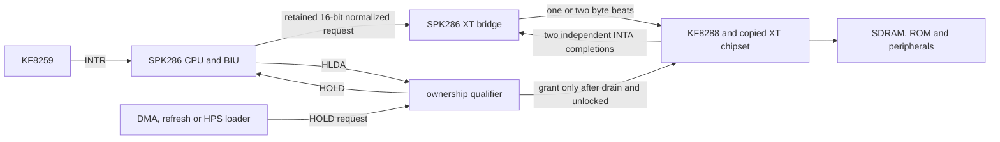

# I4 machine integration contract

I4 replaces the copied machine project's MCL86/i8088 CPU owner with the pinned
SPK286 wrapper and retains the PCXT peripheral implementation. The original
`PCXT-EGA.sv`, `files.qip`, `Chipset.sv` and `Bus_Arbiter.sv` remain unchanged.
The production variant is selected only by `PCAT-286.qsf`.

## Clock and bus scheduling

- SPK286, the retained-request bridge and the XT chipset use the same
  `clk_chipset` domain. There is no bit-by-bit asynchronous payload crossing.
- SPK286 may execute internally on every domain clock. `cpu_ce_posedge` starts
  each legacy XT byte beat; the OSD setting is therefore named **XT Bus Pace**,
  not CPU frequency.
- The bridge holds address, status, direction, lane, data and LOCK until an
  active KF8288 command and qualified READY are observed. Passive or stale
  READY cannot finish a request.
- An aligned 16-bit request becomes two independently mapped byte beats. The
  CPU receives READY only after the final beat. Odd byte transfers use D15:8.
- CPU memory addresses are projected independently to the initial 20-bit
  `XT_COMPAT` profile. Thus native reset address `FFFFF0h` reads XT address
  `FFFF0h`. I/O addresses retain their low 20 bits without memory alias labels.

## Interrupt contract

The existing KF8259 drives SPK286 `intr`. A CPU external-interrupt entry emits
two separate normalized INTA requests. Each becomes one KF8288 INTA command;
the first response is ignored and D7:0 from the READY-qualified second response
is the vector. LOCK remains active over both acknowledgements and the first
complete frame word. The integration does not derive an acknowledgement from
INTR and does not hard-code the vector.

The production NMI input remains tied low because the selected PCXT machine has
no implemented parity/channel-check source. A verification-only NMI input in
the event bench checks the CPU entry and IRET path without claiming a physical
machine source.

## Ownership, reset, loader and pause

- `Bus_Arbiter_SPK286.sv` exposes the combined DMA/external request rather than
  synthesizing an acknowledgement from passive CPU status.
- Runtime access reaches SPK286 HOLD. The chipset sees a grant only after real
  HLDA, bridge idle and LOCK inactive. A request cannot split a serialized word
  or the locked interrupt-entry span.
- Initial ROM loading is a separate reset-held owner. It does not wait for HLDA
  from a CPU that is deliberately in reset. Runtime loading follows HOLD/HLDA.
- Reset clears the CPU and bridge so an old READY response cannot replay a
  cancelled transaction.
- `execute_enable` remains asserted. It is not used as a frequency divider or
  presented as a safe whole-machine pause. The inherited F12 CPU-pause shortcut
  is not enabled in `hps_io`; F12 retains MiSTer's normal OSD behavior. A future
  pause implementation needs an explicit CPU quiesce/response-retention
  contract rather than dropping `execute_enable` at a guessed bus boundary.

## Diagnostic ROM loading and observation

`tests/firmware/pcat286_event_diag.rom` is a raw 64 KiB image for physical
addresses `F0000h-FFFFFh`. In MiSTer, load it from **System & BIOS -> PCAT
Main/Diagnostic ROM** (file slot/index 0). The inherited reset hold also
requires an EGA option ROM in **System & BIOS -> EGA BIOS** (slot/index 3).
No EGA or production system BIOS is distributed by this integration.

The ROM writes the exact pass sequence `70h,72h,71h,86h` to port `80h` and
uses port `81h` for failure codes. The passive production monitor lights the
disk LED after the complete pass sequence; the user LED indicates a diagnostic
failure or a CPU/bridge fault. The monitor neither acknowledges nor changes a
bus transfer. These LEDs make I6 repeatable, but their behavior has not yet
been observed on a physical board.

The diagnostic ROM is an acceptance asset, not a production BIOS adaptation.

The production `pcat_rom_loader` is exercised dynamically in both portable
simulators. The test transfers all 32,768 WIDE=1 input words, observes exactly
65,536 serialized byte writes from `F0000h` through `FFFFFh`, checks first,
interior and last data, marks the main image present, loads the EGA presence
path at `C0000h`, and verifies that the composed missing-ROM hold releases only
after both images are present.
