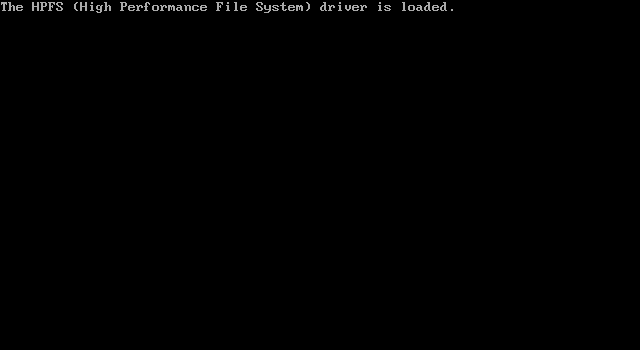
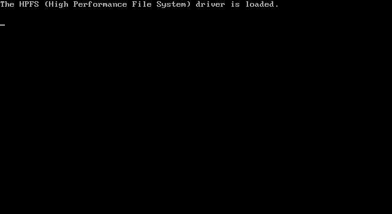

# OS/2: compare PCAT CPU options in the 86Box harness

Date: 2026-09-30. PCAT revision `9bd3faf` (SPK286 H06 imported).

## Question and result

OS/2 1.3 remains on its initial copyright screen on MiSTer, while the same
disk advances in the SPK286-backed 86Box harness. Both builds consume this
repository's `vendor/spk286` RTL and generated microcode, but Quartus enables
P02 fetch chaining and P05 parallel limit checks and the original Verilator
build did not.

Enabling P02 and P05 in 86Box **does not reproduce the initial-screen stall**.
Both the original executable and the P02/P05 variant advance to the message
`The HPFS (High Performance File System) driver is loaded.` The 91 logged
exception entries have identical ordered site/opcode/PE/event/vector and
event-error fields. This comparison is not an instruction-by-instruction
trace or a proof of complete CPU equivalence.

The run was deliberately stopped after this milestone, at roughly 7.5 minutes
per instance, with no claim of a completed desktop boot. No full regression
or new Quartus synthesis was performed.

## Reproducibility

- Machine: MR BIOS 286, nominal 6 MHz, 4096 KiB, EGA, IDE 0:0,
  geometry 1020/15/17; identical initial NVR files.
- Source image: `D:/ISOs/MiSTer/IBM_OS2.vhd`. Each run used an independent
  disposable copy. Its before/after SHA-256 remained
  `09c2a0dcd05cb12ea73999cd694fa5da9a647e07b9538a4bc59449c87affc036`.
- Control: `D:/GitHub/86box_dev/build/spk286/86Box-linux`, SHA-256
  `68954ca890b25af10ae8706382df365e8c4edf4177aa28e84d721bb8303ed4a2`.
- Variant: `D:/GitHub/86box_dev/build/spk286/86Box-linux-pcat-p02-p05`, SHA-256
  `9c90959037ec76ace4d30bd272729892eb778681ef7916a480bc53aca368d416`.
- The 86Box CMake option `SPK286_PCAT_CPU_OPTIMIZATIONS=ON` supplies
  `-DSPK286_P02_FETCH_CHAIN -DSPK286_P05_PARALLEL_LIMIT_CHECK` to Verilator.
  It defaults to OFF. The recorded Verilator command confirms both defines.
- Both runs used SDL's offscreen driver and monitor `fastfwd`; the monitor
  had a pseudo-terminal. Read-only CPU samples were captured every 30 seconds,
  briefly stopping all emulator threads for a coherent snapshot. Final guest
  RAM captures contain 4 MiB each.
- Trial folders beneath `D:/GitHub/86box_dev/build/spk286/`:
  `os2-pcat-options-20260930-control/` and
  `os2-pcat-options-20260930-pcat/`. Each contains configuration, NVR, manifest,
  console/log, screenshots, CPU samples and final RAM/state. The runner is
  `run_pcat_options_trial.py`; comparison is `analyze_pcat_options_trial.py`.
  Earlier `-baseline`/`-enabled` folders are preliminary harness runs without
  an active monitor and are not the reported comparison.
- The normal build cache was restored to OFF; rebuilding produced exactly
  the original control executable hash. The normal launcher was not replaced.

The compact [comparison record](evidence/os2-pcat-options-20260930/comparison.json)
includes the initial NVR hashes and final CPU state summaries. At the final
capture, the control was at `0228:768E` and the variant at `02DF:29E9`;
halted, shutdown, control-error, microcode-fault and unsupported-opcode flags
were clear in both. These are asynchronous final samples, not a divergent
instruction comparison.

## Host shutdown incident

The control process exited normally. After requesting the variant's exit,
its console reported `corrupted double-linked list` and it terminated with
SIGABRT (return code -6). The HPFS screenshot and final CPU/RAM captures
precede this host-process failure. Its origin is unresolved; it must not be
reported as a clean shutdown or attributed to an SPK286 architectural fault
without further evidence. The variant remains a diagnostic executable.

## Implications for the MiSTer investigation

The result reduces the likelihood that enabling P02/P05 alone explains the
initial-screen stall. It does not cover PCAT's P01/P06 bridge, actual READY
waits, HOLD/arbitration, SDRAM/code-buffer coherence, device IRQ timing or
FPGA propagation delays. CPU behavior under those conditions remains in scope.

The RBF inspected during that experiment (`output_files/PCAT-286.rbf`, identical to
`PCAT-286-BETA-03.rbf`) has SHA-256
`4ff552ea7fcfeda4a55472dcbdb9060f96fa7e50188f2238305581d3d200d906`.
Compilation started on 2026-09-29 at 21:07 local time, after the H06 commit at
21:05, and generated the RBF at 21:30. Quartus reports use UTC for this run.

Its existing TimeQuest report has setup slack -2.868 ns on `FPGA_CLK2_50`
and reports 43.73 MHz Fmax in the slow 100 C corner for that 50 MHz domain;
another video-related setup group has -5.122 ns. These are failures under the
current constraints, not proof of the OS/2 failure mechanism. Inspect actual
path endpoints before deciding which logic or constraints require correction.

Next discriminate the physical failure with CS:IP/micro-PC, progress counters,
bus/READY/HOLD state, ATA status/IRQ14 and PIC state at the freeze, and review
the failing timing paths. No hardware-side state capture was obtained in this
86Box experiment.
