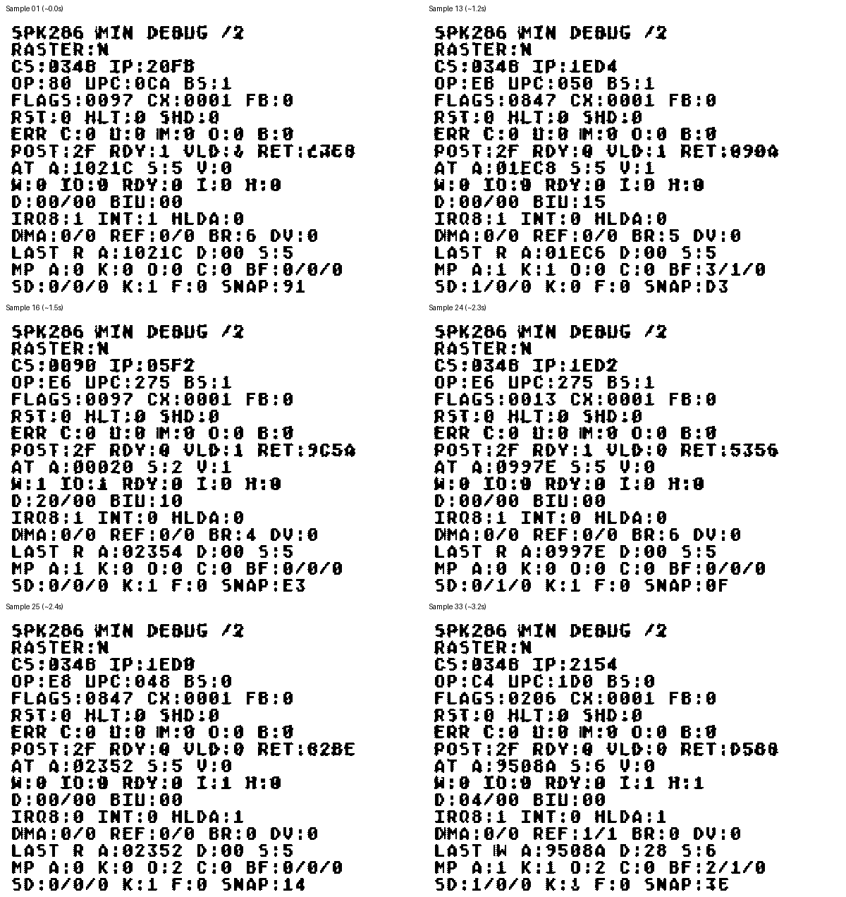

# OS/2 boot stall and RTC interrupt frequency

Date: 2026-09-30. PCAT revision `9bd3faf177f22f49b8ebf410faa7c132d257d49f`,
with the existing CPU 25 MHz diagnostic configuration.

Follow-up: the [RTC correction and focused validation](AT_RTC_PERIODIC_RATE_FIX.md)
are now implemented, with `config.tcl` restored to 50 MHz without the observer.
The user subsequently confirmed on 2026-09-30 that the RTC fix worked on
MiSTer. The analysis below records the pre-correction video/source evidence.

## Finding

The hardware video shows active execution concentrated in RTC interrupt
handling and related kernel routines. Source inspection identifies a concrete
PCAT chipset defect: the RTC periodic interrupt ignores register A's rate
selection. OS/2 configures 32 Hz in the successful 86Box reference runs, while
PCAT supplies approximately 12.2 kHz of periodic events.

An excessive IRQ8 workload was the leading explanation for the apparent boot
stall. The rate-selection defect was established from the RTL, and the user
subsequently reported success with the correction on hardware. This observation
does not establish a new SPK286 protected-mode defect.

## Video evidence

Input: `D:/Videos/2026-09-30 06-44-14.mp4`, 1920 x 1082, 30 fps,
approximately 3.333 seconds. Extracted 33 overlay samples at 10 fps with
`fps=10,crop=600:400:280:55`. Sample times are approximate. A color mask
separates the colored observer text from the grey OS/2 background for reading;
an original crop is preserved as well.

- `CS:IP`, microcode position, `RET`, and `SNAP` change. Execution is alive.
- Reviewed snapshots show `RST=0`, `HLT=0`, `SHD=0`, `FB=0`, and clear
  observer error flags. These are sampled values, not a continuous error log.
- IRQ8 is frequently asserted. INT and HLDA vary; the video does not show
  a permanent memory transaction or bus ownership freeze.
- Sample 16 shows an I/O write to port `0020h` with data `20h`, matching the
  master PIC end-of-interrupt command at the corresponding reference code site.



The [33-sample CS:IP contact sheet](evidence/os2-rtc-video-20260930/register-contact.png),
[original PIC EOI crop](evidence/os2-rtc-video-20260930/pic-eoi-original.png), and
[input hashes and transcribed addresses](evidence/os2-rtc-video-20260930/analysis.json)
preserve the observations. No interrupt frequency is measured from video;
the frequency below is derived from the source.

## Correlation with the same OS/2 image in 86Box

Reference RAM comes from the previous successful-to-HPFS control trial:
`D:/GitHub/86box_dev/build/spk286/os2-pcat-options-20260930-control/guest-ram-final.bin`.
Using its GDT at `110020h` gives these segment bases:

| Selector | Reference base | Relevant sampled activity |
| --- | --- | --- |
| `0348` | `0FFFF0h` | RTC register accesses, status-C reads, timer accounting |
| `0090` | `000900h` | PIC end-of-interrupt helper |
| `01F8` | `001F80h` | Kernel callbacks and return paths |

This is a correlation against reference RAM, not a memory dump of MiSTer.
Agreement of observed opcodes and the PIC I/O transaction supports the mapping.
The observer displays the current architectural IP, which may already have
advanced past the opcode; do not treat it as an instruction-start trace.

| Approximate video time | Displayed CS:IP | Reference interpretation |
| --- | --- | --- |
| 0.0 s | `0348:20FB` | Time accounting inside the RTC handler |
| 0.1 s | `0348:235A` | Helper reading RTC status C |
| 0.7 s | `01F8:67CB` | POPA/RETF end of a callback reached by the handler |
| 1.2 s | `0348:1ED4` | Helper selecting/reading RTC ports `70h/71h` |
| 1.5 s | `0090:05F2` | `OUT 20h,AL` with `AL=20h` immediately before IRET |
| 2.3 s | `0348:1ED2` | `OUT 70h,AL` within the RTC access helper |
| 2.7 s | `0348:2362` | Completion of the status-C helper |
| 3.2 s | `0348:2154` | Callback dispatch inside the RTC handler |

The reference driver contains `MOV AX,2B8Ah` at `0348:202E`, followed by
a call to the helper at `1ED7`. That helper writes AL to port `70h` and AH
to port `71h`: RTC register A receives `2Bh` (bit 7 in the port-70 index
masks NMI). Both previous trials also saved actual NVR values **A=2Bh,
B=52h**, confirming 32 Hz with periodic interrupts enabled in those runs.
These saved files do not directly expose the hardware RTC register values.

The handler increments its millisecond counter by 31,31,31,32 and its
centisecond counter by 3 with a 4 every eighth event. Both agree with
32 periodic events per second.

## Defect in PCAT

`PCAT-286.sv:802-820` generates the source pulse at 50 MHz:

```systemverilog
periodic_tick <= (tick_counter[11:0] == 12'h000);
```

That is normally one pulse per 4096 clocks, or one every 81.92 microseconds.
The counter wraps every 50,000,000 clocks, so the steady source produces
12,208 pulses per second including the shortened interval at the wrap.

`rtl/spk286_integration/spk286_at_rtc_cmos.sv:441` uses that pulse directly:

```systemverilog
if (periodic_tick && cmos_q[7'h0B][6]) begin
    status_c_periodic_q <= 1'b1;
    irq8_q <= 1'b1;
end
```

Register A's low four bits are stored and readable but do not select the
periodic frequency. At OS/2's requested 32 Hz (31.25 ms), the source event
rate is **381.5 times too high**. This is not a count of interrupts actually
serviced: pending events coalesce while flags remain set, and the PIC and CPU
affect delivery. It can nevertheless keep reasserting IRQ8 after status-C
reads and occupy execution in repeated interrupt handling.

CPU division by two does not divide this generator: it remains in `CLK_50M`.
This explains why the CPU-frequency experiment would not cure this defect.

The RTC also gates PF itself with PIE. Correct behavior latches PF at the
selected periodic rate independently of PIE; PIE controls IRQ assertion.
Periodic divider enable/reset behavior also needs coverage in the correction.

## Reference behavior and coverage gap

In `D:/GitHub/86box_dev/src/nvr_at.c:502`, `timer_load_count()` reads register
A's rate selection and selects a divider. For `RS=0Bh`, the divisor is
`1 << (11-1) = 1024` from 32768 Hz, giving 32 Hz. `timer_intr()` sets PF
and separately recomputes IRQ; writes to A reload the period.

The manufacturer's [DS12885/DS12887 datasheet](https://www.analog.com/en/ds12885/datasheet),
Table 3 on page 19, specifies RS=`1011` as 31.25 ms/32 Hz. Pages 16-18
describe PF/PIE and clearing interrupt flags by reading register C. This
is a compatible AT RTC reference; device-specific oscillator modes should
be matched deliberately when implementing the divider.

The dedicated `sim/spk286_integration/spk286_at_rtc_cmos_tb.sv` initializes
`periodic_tick` to zero and never pulses it. Its interrupt checks exercise
alarm/update flags and clearing, not periodic rate programming or the
top-level pulse generator. Thus those passing checks did not cover this fault.

86Box supplies its own RTC/PIC/chipset even with the SPK286 CPU enabled.
The earlier [P02/P05 comparison](OS2_86BOX_PCAT_OPTIONS_20260930.md) therefore
could not expose the PCAT-specific periodic generator.

## Next correction and bounded validation

1. Implement a programmable RTC periodic divider driven by a defined timebase;
   honor rate selection, disable, and supported divider reset modes.
2. Separate event flags from interrupt enables and recompute IRQ consistently
   after enable changes and status-C reads. Preserve calendar/HPS behavior.
3. Add a focused RTC check for OS/2's A=`2Bh`, B=`52h`, verifying 32 Hz,
   status-C acknowledgement, and independent one-second updates; cover a
   second programmed rate, RS=0, and PF with PIE disabled as well.
4. Repeat this OS/2 boot on MiSTer and check whether it passes the initial
   screen. Do not hardcode 32 Hz as a general fix.

No RTL change, new synthesis, or regression execution was made for this
analysis. The existing 25 MHz configuration remains in place.

## Timing remains a separate limitation

The RBF's size (4,083,484 bytes) and modification time (2026-09-30 06:41:44)
match the user's build. `output_files/PCAT-286.sta.summary` confirms CPU
setup +4.931 ns and hold +0.247 ns in the slow 100 C corner, while
`FPGA_CLK2_50` setup is -6.838 ns. Other clock domains also have negative
setup slack. CPU timing closure alone does not establish timing closure of
the machine or exclude an additional hardware fault. The RTC defect exists
even under ideal synchronous execution of the present RTL.
