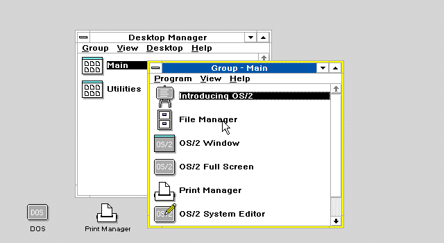

# OS/2 desktop startup stall and H09

Date: 2026-09-30. Status: **H09 implemented; focused checks passed;
OS/2 Desktop Manager reached with SPK286 in 86Box and accepted by the user**.

After the PCAT RTC correction, the user reported that OS/2 1.3 passes driver
loading but remains at a blinking cursor on both MiSTer and SPK286-backed
86Box. The new evidence identifies the pending **H09, JMP through a call
gate**, in the executed startup path. A reference boot with 86Box's original
286 interpreter reaches Desktop Manager with the same machine configuration
and a disposable copy of the disk.

The incorrect gate rejection is established. The authorized correction,
focused verification and accepted graphical-startup evidence are recorded
below. A subsequent hardware-only black screen remains open for diagnosis.

## Preserved live state and hardware video

The user's 86Box process was still running. Forty coherent samples were taken
by briefly stopping all its threads for each read, then resuming execution.
Two 4 MiB RAM dumps, the profile and the exception log were preserved before
telling the user they could close the application.

Live capture directory:
`D:/GitHub/86box_dev/build/spk286/os2-desktop-live-20260930-083308/`.
The running executable's SHA-256 was
`68954ca890b25af10ae8706382df365e8c4edf4177aa28e84d721bb8303ed4a2`.

The video `D:/Videos/2026-09-30 08-28-55.mp4` contains approximately 2.933
seconds at 30 fps. Twenty-nine observer samples were extracted at 10 fps.
Both video and emulator samples show the same code around `01F8:2CC6..2CF1`
and `01F8:3326..3331`; all 29 video CS samples are `01F8`.

The loop is software waiting for work:

```asm
01F8:3326  STI
01F8:3327  CALL 2CC6
01F8:332A  TEST BYTE [0ED4],FF
01F8:332F  JZ 3326
```

The helper temporarily selects DS=`0BF0`, tests work bits at `[0A82]`, and
returns when there is none. The captured `0BF0` base is `00BF00h`; both the
work word at physical `00C982h` and the byte at `00CDD4h` are zero.
The later loop shows the resulting wait, not the original failing instruction.

Execution and interrupt delivery continue: 2,255,686 simulated CPU clocks and
12 completed events separate the first and last snapshots. At the configured
6 MHz this is approximately 0.376 guest seconds, consistent with a 32 Hz clock
interrupt. The sampled last event vector is `70h`; halt, shutdown, unsupported
opcode, control error, microcode fault and operand-blocked indicators stay zero.
This is sampling evidence, not a complete interrupt trace.

## The earlier fault matches H09

Exception snapshot 166 records:

| Field | Captured value |
| --- | --- |
| Instruction | `0516:0000`, bytes `EA 00 00 28 08` |
| Operation | `JMP FAR 0828:0000` |
| Actual result | `#GP(0828)` |
| Microcode | entry `1ECh`, PC `1EFh`, operation `A9h` |
| Source CS access / CPL | `DFh` / 2 |
| GDT base / limit | `110020h` / `1AFFh` |
| Gate at physical `110848h` | `008E 04B6 E400 0000` |
| Gate type, presence, DPL | 286 call gate, P=1, DPL=3 |
| Destination stored in gate | selector `04B6`, offset `008E` |

The gate selector's RPL is zero. Its table range, type, reserved fields,
presence, and DPL pass the JMP gate checks for the source CPL2.
SPK286 instead rejects the gate itself, reporting its selector in #GP.

`microcode/source/zzzzzzzzzz_far_pointer.mc::JMP_FAR_IMM` fetches the pointer
and invokes `VALIDATE_CS`. In `rtl/spk286_micro_executor.sv`, that validation
accepts ordinary code and task routes, but `descriptor_cs_access_valid`
requires `DESC_CODE`; there is no corresponding JMP call-gate resolution path.
This is the precise omission already recorded by H09.

Intel's 80286 Programmer's Reference Manual, JMP / **JUMP TO CALL GATE**,
permits this transfer form: check the gate, obtain CS:IP from it, validate the
target code under JMP privilege rules, and transfer without pushing a return
frame or switching to a more privileged nonconforming segment. The pointer's
immediate offset is ignored for a gate. Native 86Box has a dedicated call-gate
case in `src/cpu/x86seg.c::loadcsjmp`, also compiled for the 286 through
`x86seg_2386.c`.

The old LDT area in the much later RAM dump is no longer a reliable image of
the destination descriptor at the fault. Therefore this report does not claim
to have captured its original presence, base or limit. Even if that target
required demand loading, a target-related fault would follow gate resolution;
it would not justify rejecting this valid gate as #GP(0828).

Other #NP/#GP log entries are not automatically additional CPU bugs: OS/2 uses
segment faults for demand loading and selector management. No new connection
to H03, H10, H19 or another pending story is established here.

## Native 286 comparison

An isolated executable was linked from the existing 86Box build objects after
recompiling only `cpu.c` without `USE_SPK286_BACKEND`, selecting the original
`exec386_2386` interpreter for the 286. No source, standard build object, normal
executable or normal profile was replaced. Build commands are preserved in
`D:/GitHub/86box_dev/build/spk286/os2-desktop-native-reference/commands.json`.

The reference used MR BIOS, 286/6 MHz, 4 MiB, EGA and a private VHD copy. It ran
for 60 seconds with fast-forward enabled after five seconds, capturing screens
every five seconds. Desktop Manager is visible by the 25-second capture and
remains visible through the final samples.



Trial directory:
`D:/GitHub/86box_dev/build/spk286/os2-desktop-native-20260930-083810/`.
Native executable SHA-256:
`af294129bd0f01d3a3c90d03d4199e90f5cf602b8608dc60c8c34985555dcc8f`.
The source VHD SHA-256 remained
`a51986db0a63ce8ab64a18b91c6ee6d96ea79c225fd6ca63b2898f6befcc6c2f`
before and after the trial. Guest changes affected only the disposable copy.

After the requested monitor `exit`, the host reported
`malloc_consolidate(): unaligned fastbin chunk detected` and exited with SIGABRT.
This repeats the class of host shutdown problem seen in the earlier comparison.
It prevents claiming a clean reference exit; the captured desktop startup
preceded that incident. Its cause is unresolved, so the diagnostic executable
does not replace the user's normal executable.

## Authorized H09 correction

`rtl/spk286_micro_executor.sv` now resolves a call gate during `VALIDATE_CS`
for far JMP. This is an internal descriptor-service dependency; it does not
add an x86 decoder or a timing delay to the microsequencer. Immediate `EA`
and memory-indirect `FF /5` already share this validation operation. The
microcode image and source sequences are unchanged and pass consistency checking.

The gate supplies the target selector and offset. A fresh descriptor read
checks that target's null selector, table bounds and LDTR validity before any
target bus cycle. The target uses JMP-specific rules: nonconforming DPL must
equal CPL; conforming DPL may be less than or equal to CPL. Target RPL is
ignored and the published CS RPL retains CPL. Type and privilege errors take
precedence over absence. A valid absent gate/target raises #NP with the correct
selector; an out-of-range target offset raises #GP(0).

The target's Accessed write completes before publishing CS:IP. The route does
not build a CALL frame, copy parameters, change FLAGS, consult a TSS stack, or
change SS:SP. IDT event validation does not accept a second call gate. Ordinary
code transfers and task-gate JMP retain their existing routes.

Native 86Box is useful workload evidence, but its local `loadcsjmp` branch
does not exactly enforce Intel's nonconforming DPL equality test. The new
test expectations follow Intel's JMP algorithm rather than copying that branch.

## Focused verification

The new `sim/unit/spk286_jmp_call_gate_tb.sv` runs **816 cases / 1,704 checks**
in each of Icarus and Verilator. Coverage includes:

- Immediate and indirect forms, with a prefix included in restart state.
- Independent GDT/LDT placement of gate and code descriptor.
- CPL0..3, conforming/nonconforming code, ignored target RPL, gate DPL/RPL.
- A=0/A=1, three timing policies, READY waits and parameter count 31.
- Gate/target absence, wrong type, invalid privileges, reserved gate form,
  null/out-of-table selectors and an offset beyond the code limit.
- A real #NP handler that sets P, consumes the error code and IRETs to retry
  the original prefixed JMP, with source CS/cache and SS:SP preserved.
- Valid-looking poison descriptors outside allowed table ranges: the bank
  asserts that no descriptor read occurs there. This exposed and corrected an
  intermediate implementation that bypassed the second selector precheck;
  zero-filled memory would have concealed that defect.

The original baseline fails the first valid-gate case with #GP(0030).
The final bank passes with upstream RTL and with PCAT's P01/P02/P05/P06
compile options. Upstream full-module lint, PCAT-option core lint and unchanged
microcode consistency checking pass. Additional Icarus results:

| Existing bank | Result |
| --- | --- |
| Call-gate Accessed/retry | 420 checks / 144 cases |
| Direct protected CALL | 300 checks / 144 cases |
| Protected system | 538 checks |
| Outer-level event | 6 checks |
| Far task gate | 14 checks |
| Task-gate faults | 49 checks / 13 cases |
| Task-gate outer privilege | 232 checks / 96 cases |
| Far-transfer lifecycle | 16,318 checks / 247 cases |

Per the user's incremental-validation policy, validation was limited to the
listed focused banks. An initial shell wrapper lost its unit argument and
started the all-unit route; it was stopped in the early expand-down bank after
less than a minute, and is not counted as regression evidence. Full regression
remains deferred. No Quartus synthesis was launched by the agent.
The pinned real-mode SingleStep corpus does not cover
protected call gates. Hardware synthesis and testing are being performed by
the user; no hardware success is claimed here.

Local validation logs: `build/h09-baseline.log`,
`build/h09-target-precheck-before.log`, `build/h09-final-dual.log`,
`build/h09-lint.log` and `build/h09-spk286_*.log`.

## Application retest

The final RTL and directed bank were synchronized byte-for-byte to PCAT's
vendor tree. Its existing local `config.tcl` selection (25 MHz, debug enabled)
was preserved. The normal 86Box launcher executable was rebuilt and installed:

- `D:/GitHub/86box_dev/build/spk286/86Box-linux`.
- SHA-256 `90c980caee812bdecc6379b0f8aeb7f9b7ee8d9cf80c70d37e15e41f18779bb5`.
- Previous executable preserved as `86Box-linux.pre-h09`.
- Final trial: `build/spk286/os2-desktop-20260930-h09-final/` in 86Box.

The retest used a disposable VHD copy with 4 MiB, EGA, MR BIOS and the same
6 MHz profile as the reference. Fast forward was enabled, with coherent CPU
samples and screenshots every 30 seconds. Observation was extended beyond the
initial 40-minute deadline while the graphical session continued loading.
The earlier `h09` and `h09-fixed` trial directories are aborted setup/intermediate
runs and are not final application evidence.

### Accepted result

The final screenshot shows **Desktop Manager**, its Main and Utilities groups,
and the DOS desktop icon. The pointer is still an hourglass; the user accepted
this visible startup progress and requested that this instance be closed.
The emulator exited normally with return code 0 after **2,626.46 seconds
(43 minutes 46 seconds)**. This validates the H09 workload fix and reaching
Desktop Manager; it does not establish completion of all startup work or
general OS/2 application compatibility.

The exception comparison provides evidence independent of the screen:

- The first 165 exception signatures match the previous failing run exactly.
- The former snapshot 166, `0516:0000 EA`, #GP(0828), is gone from that
  position. The new snapshot 166 is later loader activity at `041E:1147`.
- New snapshot 175 executes at `04B6:05E4`, inside the call gate's target code
  segment, demonstrating that execution progressed through the formerly
  rejected transfer. Its #NP(04EC) is followed by continued graphical startup.

The comparison file was captured when the new log contained 175 snapshots;
it is an intermediate comparison, not the final exception count. Logging is
bounded to 256 exception snapshots and is not a complete instruction trace.
The final CPU sample has shutdown, unsupported-opcode, control-error,
microcode-fault and operand-blocked indicators clear, with 4,401 event requests
and completions.

Much of the wait was CHKDSK scanning the private disk copy. Two observed loops
advanced their counters toward 260,080 entries, completed, and were followed
by driver loading and the graphical session. The long delay was not evidence
of a stationary CPU loop.

The original `D:/ISOs/MiSTer/IBM_OS2.vhd` was unchanged: its SHA-256 before and
after the trial is
`a51986db0a63ce8ab64a18b91c6ee6d96ea79c225fd6ca63b2898f6befcc6c2f`.
The trial's private VHD was allowed to receive normal guest writes.

### Hardware follow-up remains open

After accepting the emulated result, the user reported that a hardware build
without debug progressed from the blinking cursor to a fixed black screen.
They are synthesizing a debug build to supply register samples in a short
video. That symptom alone does not identify CPU, peripheral, video, bus or
timing failure. The successful 86Box run establishes one working integration;
it does not validate the PCAT hardware path. No additional RTL change is
included for this unclassified hardware observation.

Final evidence: [SPK286 Desktop Manager screenshot](evidence/os2-desktop-20260930/spk286-desktop-manager.png),
[trial manifest](evidence/os2-desktop-20260930/h09-final-manifest.json),
[final CPU state](evidence/os2-desktop-20260930/h09-final-state.json),
[exception comparison](evidence/os2-desktop-20260930/h09-fault-comparison.json).

Compact evidence: [fault 166](evidence/os2-desktop-20260930/fault-166.txt),
[hardware register samples](evidence/os2-desktop-20260930/hardware-registers.png),
[live-state summary](evidence/os2-desktop-20260930/summary.json),
[idle loop](evidence/os2-desktop-20260930/idle-loop.asm).
